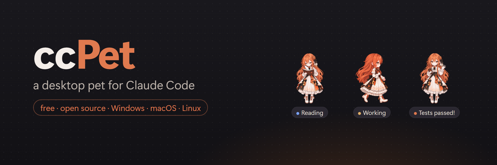

<p align="center"></p>

<p align="center">
  <b>English</b> · <a href="README.ru.md">Русский</a><br>
  <a href="https://github.com/S1NexZ/ccPet/releases/latest"><b>Download</b></a> ·
  <a href="#quick-start">Quick start</a> ·
  <a href="#is-it-safe">Is it safe?</a> ·
  <a href="#support-the-project">Support ❤</a>
</p>

# ccPet

**ccPet is a free, open-source desktop pet for [Claude Code](https://code.claude.com).** It sits on your screen, shows what Claude is doing, and lets you talk to your sessions without switching windows: answer Claude's questions, approve actions, queue your next task, and watch the pet cheer when your tests pass.

Works with Claude Code in **Windows terminals, WSL, the Claude desktop app, macOS and Linux**. The interface speaks English, Russian and Chinese.

> An unofficial, independent project, not affiliated with Anthropic. "cc" stands for "Claude Code".

## What it does

- **Shows what Claude is doing.** Thinking, reading, writing, running commands, testing, waiting for you, done or asleep: the pet animates each state, driven by Claude Code hooks.
- **Answers Claude's questions.** When Claude asks you something with options, the pet shows them as buttons. Pick one, type your own answer, or leave it to the terminal. `Ctrl+Alt+1…9` presses a button from any window.
- **Approves actions** (optional). Allow or deny tool permissions right from the pet.
- **Shares one live session with your terminal.** Type from the pet or the terminal: it is the same Claude Code process and the same transcript, no second copy.
- **Queues messages.** Write while Claude is still working: the message goes in when the turn ends. `/at 23:30 run the tests` sends it at a set time, `/at reset continue` right after your 5-hour limit resets.
- **Summarizes each turn.** After a turn that changed files you get a card: files, +/− lines, time and tokens.
- **Reacts.** Tests pass or a commit lands: the pet jumps and waves. Tests fail: it looks sad.
- **Shows your plan limits.** A ring next to the pet tracks the 5-hour and weekly Claude limits.
- **Chat commands.** `/model`, `/btw`, `/stop`, `/at`, `/compact`, `/clear` and more, with a menu as you type `/`.
- **Custom pets.** Install any pet in the Codex pet format (`pet.json` + sprite sheet) from a ZIP. Recolor the pet and the interface to taste.

## Quick start

1. **Download** the installer for your system from [Releases](https://github.com/S1NexZ/ccPet/releases/latest):
   | System | File |
   |---|---|
   | Windows 10/11 | `ccPet_<version>_x64-setup.exe` |
   | macOS (Apple silicon and Intel) | `ccPet_<version>_universal.dmg` |
   | Linux (Ubuntu, Debian) | `ccPet_<version>_amd64.deb` |
   | Linux (other) | `ccPet_<version>_amd64.AppImage` |

   **Upgrading from 0.6 on Windows:** 0.7 installs to `%LOCALAPPDATA%\ccPet`. Quit the old ccPet and uninstall it in "Installed apps": both cannot run at once (one port, one hotkey). Settings, pets and connected hooks stay.
2. **Connect Claude Code hooks:** Settings (⚙) → Connections. The pet shows the exact change to `~/.claude/settings.json`, keeps a `.bak` copy and applies it only after you agree. Without hooks the pet cannot see your sessions.
3. **Optional: connect the terminal** (tray → "Connect the terminal"). Then the pet can type into your terminal session directly and stop it with Esc.
4. Run `claude` as usual. The pet picks up the session; `Ctrl+Alt+P` opens the chat.

### Recommended: the ccPet plugin for Claude Code

Type this once in Claude Code (2.1.287 or later):

```
/plugin install ccpet --marketplace S1NexZ/ccPet
```

The plugin runs inside Claude Code (terminal, the Code tab of the Claude app, VS Code). With it, what you write in the pet arrives in the session as your own message, with no terminal wrapper and no typing into the app's window, and the pet gets your plan limits straight from Claude Code. It only talks to the pet on `127.0.0.1`; `claude plugin validate` lists every call it makes. WSL sessions inside the Claude app do not load plugins, so hooks stay in use there.

In the terminal the plugin also draws a row above the prompt with your 5-hour and weekly limits, reset time and a run-out forecast. `/ccpet limits` turns it off or on.

**First launch warnings.** The builds are not signed with paid certificates yet:
- **Windows** SmartScreen: "More info" → "Run anyway".
- **macOS**: right-click the app → "Open". If macOS says the app is damaged, run `xattr -cr /Applications/ccPet.app`.
- **Linux AppImage**: `chmod +x` the file; it needs `libfuse2` (on Ubuntu and Debian the `.deb` is simpler).

## Is it safe?

- **Your settings are never changed silently.** Every change to Claude Code's `settings.json`, `~/.bashrc` or your PowerShell profile is shown as a diff first, backed up, and can be removed from the same screen.
- **Your data stays on your computer.** The pet talks to Claude Code through local hooks (`127.0.0.1` and a unix socket with `0600` permissions). No telemetry, no accounts, no servers of its own; the only request it makes by itself is the daily update check on GitHub, which you can turn off. Details: [docs/privacy.md](docs/privacy.md).
- **It does not run a second Claude for you.** Starting Claude Code through the Agent SDK (new chats from the pet) is off by default.
- **Open source.** The whole code is here, under the MIT license.

## Requirements

- **Claude Code** installed and logged in (tested with 2.1.3xx). Limits are shown for Pro/Max subscriptions.
- **Windows**: 10 or 11, x64. For WSL sessions: WSL2 with Node.js 22 and Python 3 inside the distro.
- **macOS**: 11 or newer, Apple silicon or Intel.
- **Linux**: X11 or XWayland (the pet is a transparent always-on-top window), Python 3 for the terminal wrapper.

macOS and Linux are in **beta**: they pass automated tests and start-up checks on GitHub Actions, but have had little real-world testing. Please report what you find in [Issues](https://github.com/S1NexZ/ccPet/issues).

## Known limitations

- Exclusive-fullscreen games draw over every normal window, the pet included. Use borderless windowed mode.
- Esc pressed in the first seconds of a turn (while hooks run) may be ignored by Claude Code.
- Plan limits come from an experimental Claude Code method that may change in future versions.
- Pet models: the Codex sheet layout (8 columns × 9 or 11 rows of 192×208 cells).

More: [docs/troubleshooting.md](docs/troubleshooting.md). App log: `%APPDATA%\Claude Pet\pet.log` (Windows).

## Development

```
npm install && (cd ui && npm install)
npm run build      # bridge (build/bridge) and UI (ui/dist)
npm test           # Vitest
npm run dist:tauri # Windows installer (Tauri, from WSL): ui/release/ccPet-<version>_x64-setup.exe
```

How it works inside: [docs/design.md](docs/design.md). Changes: [CHANGELOG.md](CHANGELOG.md) (in Russian).

## Support the project

ccPet is free and will stay free: no ads, no paid features. If it made your work with Claude a bit nicer, you can support it on [Ko-fi](https://ko-fi.com/aberz) or [Boosty](https://boosty.to/cpet). A star on GitHub helps too ⭐

## License

ccPet's code is [MIT](LICENSE). Third-party assets (the bundled cPet pet, a third-party pack originally named Claude-maiden, Claude Agent SDK, Electron) have their own terms: see [THIRD_PARTY_NOTICES.md](THIRD_PARTY_NOTICES.md).
